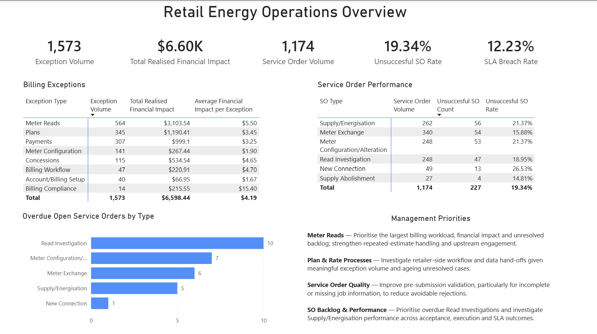
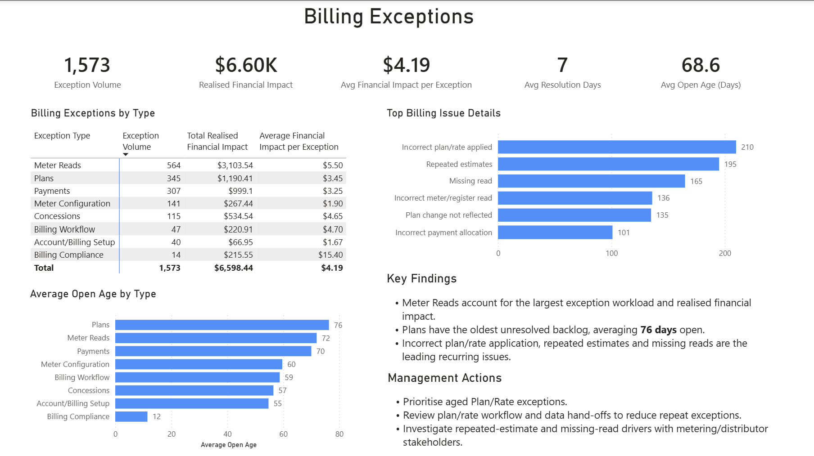
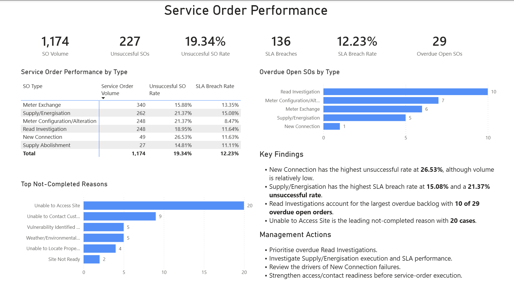

# Retail Energy Operations Analytics

A Power BI portfolio project analysing billing exceptions and service-order performance within a simulated retail energy operations environment.

The project uses a **synthetic six-month dataset** containing **1,573 billing exceptions** and **1,174 service orders**. The objective was to identify operational workload drivers, financial impact, ageing issues, unsuccessful service-order outcomes, SLA performance and overdue backlog, then translate those findings into practical management actions.

## Case Study

[View the full PDF case study](case-study/Retail_Energy_Operations_Case_Study.pdf)

## Business Problem

Retail energy operations teams manage large volumes of billing exceptions and field service orders across customers, distributors and metering providers.

Poor visibility across these processes can make it difficult to answer questions such as:

- Which billing issues create the greatest operational workload?
- Where is the largest financial impact occurring?
- Which unresolved issues are ageing the longest?
- Which service-order types have the weakest performance?
- Where are SLA breaches and overdue orders concentrated?
- What operational actions should management prioritise?

This project was designed to answer those questions through an end-to-end Power BI analysis.

## Dataset

The analysis uses synthetic retail energy operational data covering a six-month period.

Key fact tables include:

- **Billing Exceptions** — exception type, issue detail, reported and resolution dates, status and realised financial impact.
- **Service Orders** — service-order type, operational outcomes, SLA performance, raised and finalisation dates and non-completion reasons.

Supporting dimensions include:

- Customer
- Date
- Distributor
- Metering Provider

The dataset is entirely synthetic and does not contain confidential customer or employer data.

## Data Model

The Power BI model was structured using a **star-schema approach**.

Billing exceptions and service orders are maintained as separate operational fact tables connected to shared dimensions.

Multiple operational dates are supported within the model, enabling analysis based on both when an issue was raised or reported and when it was resolved or finalised.

## Analysis

The analysis focused on four main areas:

### Billing workload and financial impact

- Exception volumes
- Realised financial impact
- Average financial impact per exception
- Recurring issue drivers

### Exception resolution and ageing

- Average resolution time
- Open exception ageing
- Identification of ageing operational backlogs

### Service-order performance

- Service-order volumes
- Unsuccessful outcomes
- Unsuccessful rates by order type
- Reasons for non-completion

### SLA and backlog performance

- SLA breaches
- SLA breach rates
- Overdue open service orders
- Backlog concentration by service-order type

## Dashboard

The final Power BI report contains three management-focused pages.

### 1. Operations Overview

Provides a consolidated view of headline operational KPIs, billing exception performance, service-order performance and management priorities.

### 2. Billing Exceptions

Examines billing workload, realised financial impact, recurring issue drivers, resolution performance and unresolved ageing.

### 3. Service Order Performance

Examines unsuccessful service-order outcomes, SLA performance, overdue open work and reasons for non-completion.

## Key Findings

- **Meter Read exceptions represented the largest billing workload and realised financial impact**, making them the most significant exception category by both volume and cost.
- **Plan-related exceptions contained the oldest unresolved backlog**, averaging approximately **76 days open**.
- **New Connections recorded the highest unsuccessful service-order rate at 26.53%**, although the category represented relatively low volume.
- **Supply/Energisation recorded the highest SLA breach rate at 15.08%**.
- **Read Investigations represented the largest overdue open backlog**, accounting for **10 of 29 overdue service orders**.
- **Unable to Access Site** was the most common recorded reason for non-completion, with **20 cases**.

## Management Recommendations

- Prioritise ageing **Plan and Rate** exceptions and review associated workflow and data hand-offs.
- Investigate recurring **Meter Read** issues such as repeated estimates and missing reads with relevant metering and distributor stakeholders.
- Review **Supply/Energisation** execution and SLA performance.
- Investigate the drivers behind the comparatively high unsuccessful rate for **New Connections**.
- Prioritise overdue **Read Investigations**.
- Strengthen customer-contact, site-access and job-readiness checks before service-order execution.

## Tools & Techniques

**Power BI · Power Query · DAX · Star Schema Data Modelling · Operational KPI Analysis · Data Visualisation · Business Analysis · Data Storytelling**

DAX measures were developed for metrics including exception volumes, financial impact, resolution and ageing measures, unsuccessful service-order rates, SLA breach rates and overdue operational backlog.

## Project Status

**Power BI report and portfolio case study complete.**

Current repository includes:

- Three-page Power BI dashboard
- Dashboard screenshots
- PDF case study

Planned addition:

- Project-specific SQL analysis
